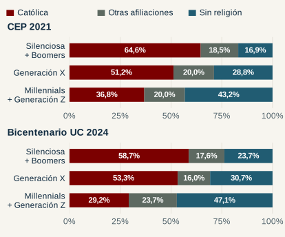
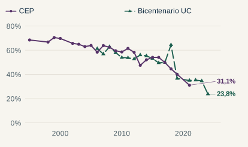
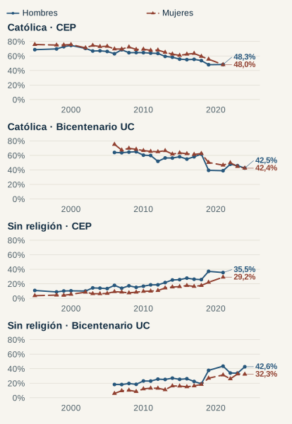
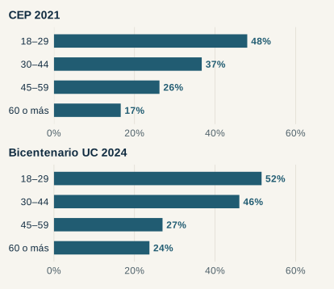
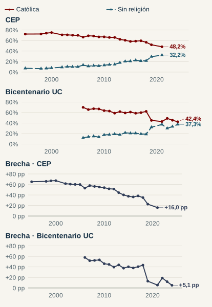
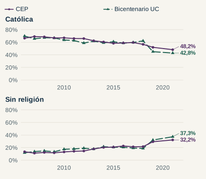

::::: {.analisis-contenedor .editoriales role="region" aria-label="Preguntas sobre el cambio religioso"}

## Preguntas sobre el cambio religioso {#preguntas-cambio-religioso}

Seis historias sobre la identificación religiosa en Chile, a partir de respuestas válidas ponderadas de CEP y Bicentenario UC. Cada proporción requiere al menos 30 casos en la categoría y 30 en el resto de su grupo. Cada segmento de las barras de composición también debe alcanzar ese mínimo.

[Consultar la auditoría metodológica](auditoria-editorial.qmd) · [Descargar las estimaciones (CSV)](editoriales/estimaciones.csv)

:::: {.editorial-historia}

::: {.editorial-texto}
### La no afiliación es más frecuente en las cohortes jóvenes {#composicion-generacional}

[¿Cómo se distribuye la identificación religiosa entre generaciones?]{.editorial-pregunta}

Entre Millennials y Generación Z, el 43,2 % declaró no tener religión en CEP y el 47,1 % en Bicentenario UC. Entre la Generación Silenciosa y los Boomers, las proporciones fueron 16,9 % y 23,7 %, respectivamente.
:::

::: {.editorial-datos}
```{=html}
<figure class="editorial-figura">
  
  <figcaption>Encuesta CEP (2021) y Encuesta Bicentenario UC (2024). Elaboración OCRC.</figcaption>
</figure>
<p class="editorial-metodo">Las cohortes se estiman restando la edad al año de la encuesta. Se reúnen Millennials y Generación Z (1981–2012) para alcanzar el mínimo de casos en CEP. «Otras afiliaciones» reúne a evangélicos y demás religiones. Cada barra describe una cohorte observada en el año indicado.</p>
```


:::
::::

:::: {.editorial-historia}

::: {.editorial-texto}
### Menos jóvenes se identifican como católicos {#catolicismo-joven}

[¿Cómo cambió la identificación católica entre los 18 y los 29 años?]{.editorial-pregunta}

Entre el primer y el último año disponible, la proporción bajó del 68,4 % al 31,1 % en CEP y del 61,3 % al 23,8 % en Bicentenario UC.
:::

::: {.editorial-datos}
```{=html}
<figure class="editorial-figura">
  
  <figcaption>Encuesta CEP (1995–2021) y Encuesta Bicentenario UC (2006–2024). Elaboración OCRC.</figcaption>
</figure>
<p class="editorial-metodo">Cada año representa a personas de 18 a 29 años de la muestra correspondiente. Las encuestas son cortes transversales con distintos encuestados en cada levantamiento.</p>
```


:::
::::

:::: {.editorial-historia}

::: {.editorial-texto}
### Más hombres que mujeres declaran no tener religión {#brecha-genero}

[¿Cómo han variado el catolicismo y la no afiliación según el sexo registrado?]{.editorial-pregunta}

En el último año de cada encuesta, el 35,5 % de los hombres y el 29,2 % de las mujeres declararon no tener religión en CEP. En Bicentenario UC, las cifras fueron 42,6 % y 32,3 %. La identificación católica fue cercana entre ambos grupos en esos años.
:::

::: {.editorial-datos}
```{=html}
<figure class="editorial-figura">
  
  <figcaption>Encuesta CEP (1995–2021) y Encuesta Bicentenario UC (2006–2024). Elaboración OCRC.</figcaption>
</figure>
<p class="editorial-metodo">Se usan las dos categorías de sexo registradas por las encuestas. Los porcentajes se calculan dentro de cada grupo. Los años en que una proporción queda por debajo del mínimo de casos aparecen sin estimación.</p>
```


:::
::::

:::: {.editorial-historia}

::: {.editorial-texto}
### La no afiliación es menos frecuente entre las personas de mayor edad {#no-afiliacion-edad}

[¿Qué proporción declara no tener religión en cada grupo etario?]{.editorial-pregunta}

En CEP 2021, el 48,0 % de las personas de 18 a 29 años declaró no tener religión, frente al 16,6 % de las de 60 años o más. En Bicentenario UC 2024, las proporciones fueron 51,5 % y 23,7 %, respectivamente.
:::

::: {.editorial-datos}
```{=html}
<figure class="editorial-figura">
  
  <figcaption>Encuesta CEP (2021) y Encuesta Bicentenario UC (2024). Elaboración OCRC.</figcaption>
</figure>
<p class="editorial-metodo">Se muestran estimaciones puntuales ponderadas. Las bases consolidadas carecen de información suficiente para reconstruir ambos diseños muestrales y calcular intervalos de confianza válidos.</p>
```


:::
::::

:::: {.editorial-historia}

::: {.editorial-texto}
### Se estrecha la distancia entre católicos y personas sin religión {#brecha-catolicismo}

[¿Cuántos puntos porcentuales separan ambas identificaciones?]{.editorial-pregunta}

Entre el primer y el último año observado, la brecha pasó de 65,2 a 16,0 puntos porcentuales en CEP y de 58,0 a 5,1 puntos en Bicentenario UC.
:::

::: {.editorial-datos}
```{=html}
<figure class="editorial-figura">
  
  <figcaption>Encuesta CEP (1995–2021) y Encuesta Bicentenario UC (2006–2024). Elaboración OCRC.</figcaption>
</figure>
<p class="editorial-metodo">Para cada encuesta y año, se resta el porcentaje sin religión del porcentaje católico. Ambos usan el mismo denominador ponderado dentro de cada muestra.</p>
```


:::
::::

:::: {.editorial-historia}

::: {.editorial-texto}
### Ambas encuestas registran más personas sin religión {#comparacion-encuestas}

[¿Qué muestran CEP y Bicentenario UC en los años que comparten?]{.editorial-pregunta}

Entre 2006 y 2021, la no afiliación subió del 13,4 % al 32,2 % en CEP y del 11,8 % al 37,3 % en Bicentenario UC. La identificación católica fue menor en 2021 que en 2006 en ambas fuentes.
:::

::: {.editorial-datos}
```{=html}
<figure class="editorial-figura">
  
  <figcaption>Encuesta CEP y Encuesta Bicentenario UC, 2006–2019 y 2021. Elaboración OCRC.</figcaption>
</figure>
<p class="editorial-metodo">CEP pregunta por pertenencia o cercanía y Bicentenario UC por la religión que profesa la persona. Los períodos de terreno y la cobertura también difieren. En 2021, por ejemplo, CEP incluyó población urbana y rural y Bicentenario UC cubrió el universo urbano de su diseño. En Bicentenario UC cambió el marco censal entre 2018 y 2019. Cada fuente conserva su muestra y ponderador.</p>
```


:::
::::

:::::
